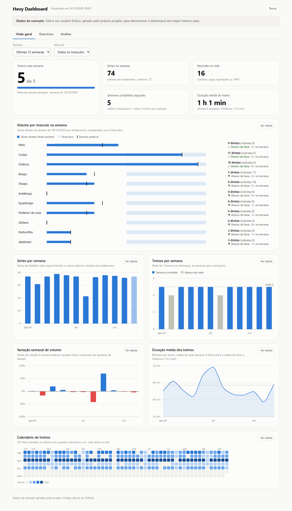
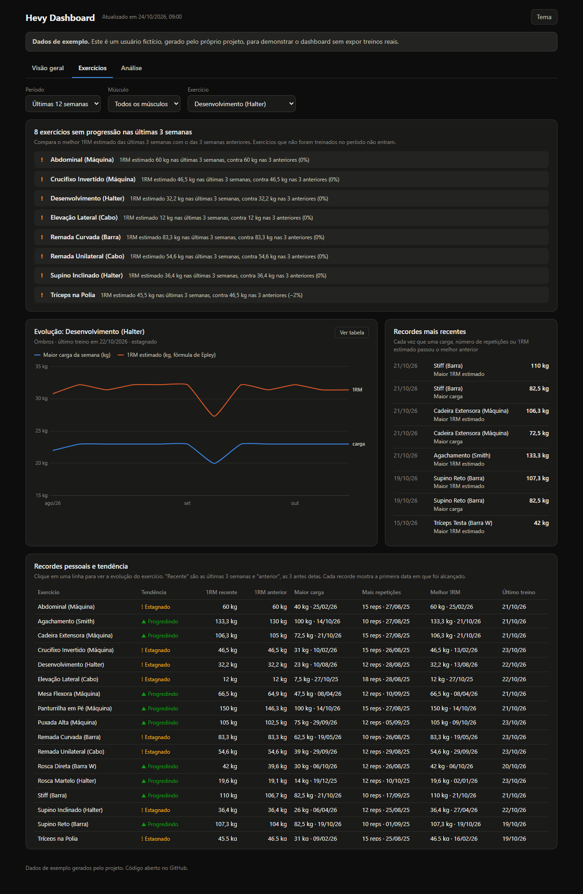
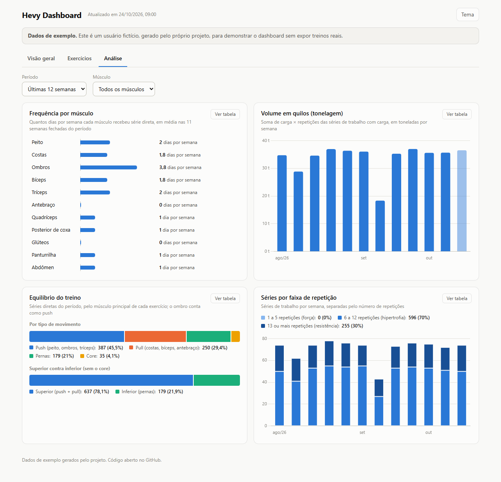
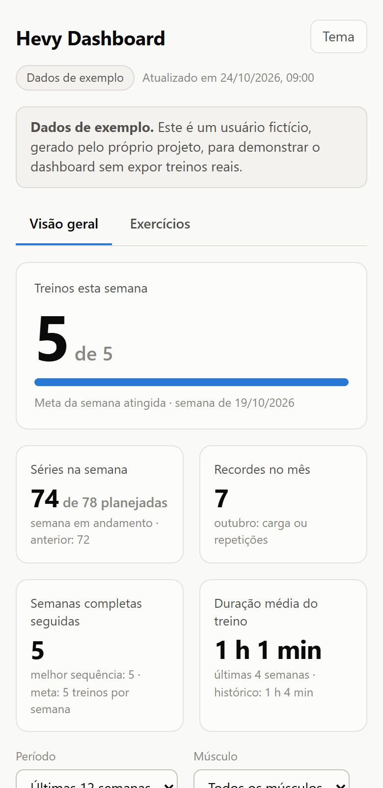
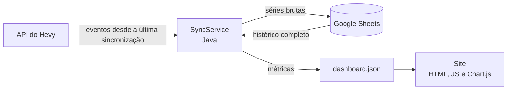

# Hevy Dashboard

[](https://github.com/gabrielcdzz/Hevy-DashBoard/actions/workflows/ci.yml)


Sincroniza os treinos do [Hevy](https://www.hevyapp.com/) com uma planilha do Google Sheets, calcula o volume semanal por grupo muscular (séries **diretas** e **indiretas**) e mostra tudo em um dashboard web: consistência, evolução de carga, recordes pessoais, alerta de estagnação e equilíbrio do treino.

**Demonstração com dados de exemplo:** https://gabrielcdzz.github.io/Hevy-DashBoard/



## O problema

O Hevy registra cada série, mas não responde às perguntas de quem treina com método:

- Quantas séries de cada músculo eu fiz **nesta semana**, contando também o trabalho indireto (o supino treina o tríceps)?
- Estou dentro da faixa que planejei para cada músculo?
- Em quais exercícios eu parei de evoluir?
- Meu treino está equilibrado entre empurrar e puxar, parte superior e inferior?
- Estou sendo consistente, semana após semana?

## A solução

Um programa em Java que lê a API do Hevy, guarda cada série em uma planilha (para o histórico ser seu e as regras poderem mudar sem perder nada) e gera um arquivo de dados que um site estático transforma em gráficos.

- **Sincronização incremental.** A cada execução o programa pede ao Hevy só os treinos que foram salvos, editados ou apagados desde a última vez. Importar um histórico de alguns anos (centenas de treinos) leva cerca de 30 segundos; as execuções seguintes, cerca de 10.
- **Regras de contagem explícitas e testadas** (veja abaixo), com os números conferidos à mão contra o próprio Hevy.
- **Configuração na própria planilha:** faixa-alvo por músculo, níveis de volume, fases (cutting, bulking), meta de treinos por semana. Nada disso exige mexer em código.
- **Dashboard com três abas**, filtros de período, músculo e exercício, modo claro e escuro, versão para celular e uma tabela equivalente para cada gráfico.

## Capturas

| Exercícios (modo escuro) | Análise |
|---|---|
|  |  |

| No celular |
|---|
|  |

Todas as imagens e o site publicado usam **dados de exemplo**: um usuário fictício gerado pelo próprio projeto.

## Como funciona



1. **Busca.** `HevyClient` lê treinos, rotinas e exercícios, com paginação e novas tentativas em caso de erro passageiro.
2. **Guarda.** `WorkoutSetsTable` grava uma linha por série na aba `series_treinos`. Ao receber um treino editado ou apagado, apaga só as linhas dele e acrescenta as novas. Aplicar os mesmos eventos duas vezes não duplica nada, então uma execução que falha no meio se corrige na seguinte.
3. **Calcula.** O pacote `service` (sem acesso a rede ou planilha) transforma as séries em volume por músculo, 1RM, recordes, tendência e consistência.
4. **Exporta.** `DashboardExporter` junta tudo em um JSON, que o site lê.
5. **Lembra.** A data da última sincronização fica na aba `estado_sync` da planilha, porque quem agenda a execução não guarda estado entre uma execução e outra.

## Regras de cálculo

| Regra | Definição |
|---|---|
| Série válida | Toda série que não é aquecimento. Séries até a falha e dropsets contam. |
| Série direta | 1 série para o grupo do músculo primário do exercício. |
| Série indireta | Conta só para **bíceps e tríceps** (nas puxadas e nos empurrões). Os outros músculos secundários que o Hevy lista são ignorados. |
| Agrupamento | Dorsal e costas superiores contam juntos como "costas". |
| Semana | De segunda a domingo, no fuso de Brasília (um treino às 22h de domingo não pode cair na semana seguinte). |
| 1RM estimado | Fórmula de Epley: `carga × (1 + repetições / 30)`. |
| Entra em 1RM e recordes | Séries de trabalho com carga e entre 1 e 50 repetições. Acima disso é tratado como erro de digitação. |
| Estagnação | O melhor 1RM das últimas N semanas não passou o das N semanas anteriores. |
| Semana completa | Pelo menos a meta de treinos por semana (configurável). |

O exemplo da regra de séries indiretas: um supino inclinado (peito) com 2 séries de trabalho vale 2 diretas de peito e 2 indiretas de tríceps. As regras ficam em `docs/contexto.md`.

## Estrutura do projeto

```
src/main/java/com/gabriel/hevydashboard/
├── client/    HevyClient (API do Hevy), HevySource (interface), modelos de resposta
├── model/     records imutáveis que espelham o JSON do Hevy
├── service/   cálculos puros: VolumeCalculator, VolumeReport, ExerciseReport, ActivityReport
├── sheets/    SheetsClient (Google Sheets), tabelas da planilha, configurações, repetição de chamadas
├── sync/      SyncService: a execução completa
├── export/    DashboardExporter e os dados de exemplo
└── Main.java  comandos: sync, sample, check
site/          o dashboard (HTML, CSS e JavaScript puros) e seus testes de navegador
docs/          plano original, decisões e estado do projeto
```

A lógica de cálculo fica isolada em `service`, sem entrada e saída, para ser testada sozinha. O acesso ao Hevy e à planilha passa por interfaces (`HevySource`, `SheetsGateway`), o que permite testar a sincronização inteira sem rede.

## Como executar

### Ver o exemplo (sem conta nenhuma)

Precisa de JDK 21, Maven e Node.js.

```bash
mvn package                                        # compila e roda os testes
java -jar target/hevy-dashboard-0.1.0-SNAPSHOT.jar sample   # gera site/data/sample.json
npx serve site                                     # abra o endereço que aparecer
```

O site precisa de um servidor local: o navegador não carrega o arquivo de dados quando a página é aberta direto do disco.

### Usar com os seus treinos

1. **Chave do Hevy.** No app, em Configurações, gere uma chave da API (exige Hevy Pro).
2. **Google Cloud.** Crie um projeto, ative a *Google Sheets API*, crie uma conta de serviço, baixe a credencial em JSON e guarde-a **fora do Git** (a pasta `secrets/` já está no `.gitignore`).
3. **Planilha.** Crie uma planilha vazia e compartilhe com o e-mail da conta de serviço, como Editor. O ID é o trecho da URL entre `/d/` e `/edit`.
4. **Variáveis de ambiente.**

   | Variável | Conteúdo |
   |---|---|
   | `HEVY_API_KEY` | a chave do Hevy |
   | `GOOGLE_APPLICATION_CREDENTIALS` | caminho do JSON da conta de serviço |
   | `SPREADSHEET_ID` | o ID da planilha |

5. **Sincronize e veja.**

   ```bash
   java -jar target/hevy-dashboard-0.1.0-SNAPSHOT.jar sync   # grava site/data/dashboard.json
   npx serve site
   ```

   Se `site/data/dashboard.json` existe, o site o usa no lugar do exemplo. Na primeira execução o programa cria as abas de configuração na planilha, já preenchidas com valores iniciais que você pode editar.

## Testes

```bash
mvn test                      # testes do Java
cd site/tests && npm ci && npm test   # testes de navegador (precisa do Google Chrome)
```

- **Java:** testes unitários dos cálculos (inclusive com as rotinas reais do autor e valores conferidos à mão), da leitura da API contra um servidor local falso, da planilha e da sincronização completa contra versões falsas do Hevy e do Sheets. Nenhum teste usa a rede.
- **Navegador:** o site é aberto no Chrome sem janela, e o teste confere tooltips, a tabela equivalente de cada gráfico, filtros, tema, troca de aba, seleção de exercício e se nada estoura a largura de um celular.
- **CI:** o GitHub Actions roda os dois conjuntos, confere que o `site/data/sample.json` está em dia com o código e publica o site.

## Privacidade e segurança

- Os **dados reais ficam na máquina do dono**. O arquivo `site/data/dashboard.json` está no `.gitignore`, e o site publicado usa só os dados de exemplo. O workflow monta a pasta publicada por uma lista explícita de arquivos, para nada além do site e do exemplo chegar ao ar.
- **Nenhum segredo** vai para o repositório: a chave do Hevy e a credencial do Google são lidas de variáveis de ambiente, e o workflow nem precisa delas.
- A chave do Hevy nunca é escrita em log ou mensagem de erro.

## Decisões e aprendizados

- **A planilha é o armazenamento.** Guardar as séries brutas (e não só os totais) permite mudar as regras depois e recalcular tudo sem perder histórico.
- **Datas lidas sem formatação.** O Google Sheets devolve datas no formato do idioma da planilha, e reinterpretá-las pode trocar dia e mês. O programa lê o valor interno (um número de dias) e converte.
- **Limite de requisições do Google.** Uma sincronização faz mais de 30 chamadas, e três execuções seguidas estouraram a cota por minuto. O cliente agora repete com espera crescente.
- **Nomes de exercícios.** A API devolve os exercícios padrão em inglês, enquanto os treinos guardam o nome no idioma do app. Só os exercícios personalizados têm o nome atualizado pelo template (e é assim que renomear um exercício junta o histórico dele).
- **Dados reais acham erros que o exemplo não acha.** Séries com 101 repetições (erro de digitação) distorciam os recordes; exercícios recriados com o mesmo nome dividiam o histórico em dois.

## Código próprio e de terceiros

**Código próprio:** tudo em `src/` (cliente da API, modelos, cálculos, planilha, sincronização, exportação) e em `site/` (`index.html`, `css/`, `js/`, `tests/`).

**De terceiros:**

| O quê | Para quê | Licença |
|---|---|---|
| [Chart.js](https://www.chartjs.org/) 4.4.7 (copiado em `site/vendor/`) | gráficos do site | MIT |
| [Jackson](https://github.com/FasterXML/jackson) | leitura e escrita de JSON | Apache 2.0 |
| Google API Client e Google Sheets API (Java) | acesso à planilha | Apache 2.0 |
| [JUnit 5](https://junit.org/junit5/) | testes do Java | EPL 2.0 |
| [puppeteer-core](https://pptr.dev/) | testes de navegador | Apache 2.0 |
| [API do Hevy](https://api.hevyapp.com/docs/) | origem dos treinos | termos do Hevy |

O projeto foi desenvolvido com apoio de um assistente de IA (Claude), e o autor revisa e responde pelo código.

## Próximos passos

- **Versão com contas**, para outras pessoas conectarem o próprio Hevy. A API do Hevy não tem login OAuth: usa uma chave pessoal, então isso pede um servidor, um banco de dados e a guarda criptografada das chaves.
- RPE médio por exercício, força relativa (1RM dividido pelo peso corporal) e o próximo recorde de cada exercício, que dependem de dados que ainda não estão preenchidos no Hevy.

## Licença

[MIT](LICENSE)
